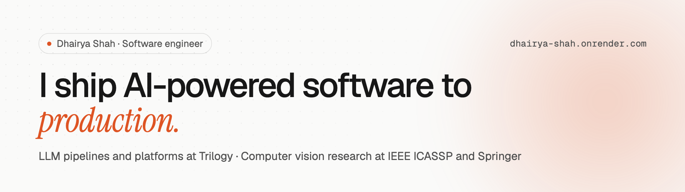

<a href="https://dhairya-shah.onrender.com/">
  <picture>
    <source media="(prefers-color-scheme: dark)" srcset="assets/banner-dark.png">
    
  </picture>
</a>

I'm a software engineer at **Trilogy Innovations (CodeNation)**, where I build LLM-backed pipelines and the platforms around them. Before that I did computer vision research at Ahmedabad University, measuring how athletes move from a single camera.

**Now:** building an AI-assisted hiring assessment, where candidates solve a real problem with an AI coding assistant and LLM judges score each session for reviewers.

### Selected work

| Project | What it is | Links |
|---|---|---|
| **SkillFound** | Job board with a match score and reasons on every listing, resume autofill, plain-English search and a hiring pipeline with ranked shortlists | [Live](https://skillfound-jobs.onrender.com/) · [Code](https://github.com/dhairya0609/SkillFound) |
| **Live Translator** | Voice and text translation that keeps conversation context, with face-to-face mode, alternatives and romanised pronunciation | [Live](https://live-translator-app.onrender.com/) · [Code](https://github.com/dhairya0609/Real-Time-Speech-Translator) |
| **Injury-risk detection** | YOLO detection of six landing-error risk factors in D-I basketball jump videos, 0.879 mAP@0.5 | [Paper](https://ieeexplore.ieee.org/document/10887636) · [Code](https://github.com/dhairya0609/Predicting-Biomechanical-Risk-Factors-for-Division---I-Women-s-Basketball-Athletes) |
| **Barbell trajectory analysis** | Markerless barbell tracking from one camera that classifies the snatch trajectory and scores lift quality | [Journal](https://link.springer.com/article/10.1007/s42979-026-04875-z) · [Code](https://github.com/dhairya0609/Barbell-Trajectory-Tracking-for-Performance-Analysis-During-Snatch-Movement-in-Weightlifting) |

### Publications

- *Single-Camera Barbell Trajectory Analysis for the Snatch Lift.* SN Computer Science (Springer), 2026. [Paper](https://link.springer.com/article/10.1007/s42979-026-04875-z)
- *Predicting Biomechanical Risk Factors for Division-I Women's Basketball Athletes.* IEEE ICASSP, 2025. [Paper](https://ieeexplore.ieee.org/document/10887636)
- *Barbell Trajectory Tracking for Performance Analysis During Snatch Movement in Weightlifting.* ISACE (Springer LNCS), 2025. [Paper](https://link.springer.com/chapter/10.1007/978-3-032-06167-6_17)

### Writing

<!-- BLOG-POST-LIST:START -->
- [IPL 2026 Curtain Raiser - Why My Top 4 Look the Way They Do](https://medium.com/@dhairyashah693/ipl-2026-curtain-raiser-why-my-top-4-look-the-way-they-do-e45e9d05332e)
- [Delhi Capitals: So Close, Yet So Far](https://medium.com/@dhairyashah693/delhi-capitals-so-close-yet-so-far-00a258dc1624)
- [Sunrisers Hyderabad: Record Scores, Mediocre Results](https://medium.com/@dhairyashah693/sunrisers-hyderabad-record-scores-mediocre-results-190f44d9da74)
- [Lucknow Super Giants: From Promising Newcomers to Perennial Underachievers](https://medium.com/@dhairyashah693/lucknow-super-giants-from-promising-newcomers-to-perennial-underachievers-79166f2c2f9b)
<!-- BLOG-POST-LIST:END -->

[More on Medium →](https://medium.com/@dhairyashah693)

### Tools I use

Plus Claude Code, LangChain and LangGraph for LLM work, and YOLO for detection.

### Elsewhere

[Portfolio](https://dhairya-shah.onrender.com/) · [LinkedIn](https://www.linkedin.com/in/dhairyashah03/) · [Medium](https://medium.com/@dhairyashah693) · [LeetCode](https://leetcode.com/u/dhairya_03/) · [Codeforces](https://codeforces.com/profile/dhairya_3) · [Email](mailto:dhairyashah693@gmail.com)
